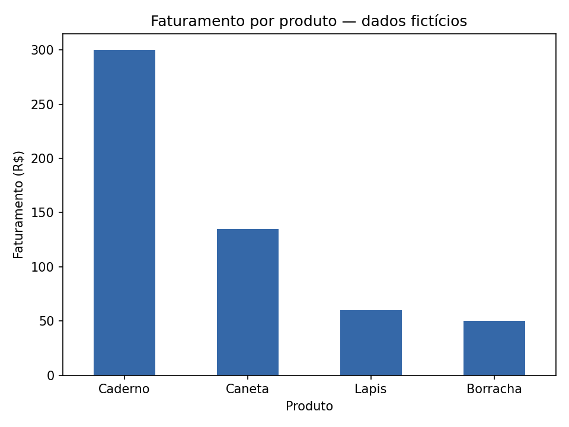

# Análise simples de vendas com Python

Um projeto de estudo para praticar **pandas e gráficos de barras** com uma pequena tabela de vendas de uma papelaria.

Os dados são **fictícios**: 20 registros, quatro produtos e cinco dias. Não representam uma loja real.

## Perguntas

- Quanto a papelaria faturou no período?
- Quantas unidades foram vendidas?
- Qual produto teve o maior faturamento?

## Executar

Com Python instalado, abra o terminal na pasta do projeto e rode:

```bash
python -m pip install -r requirements.txt
python analise_vendas.py
```

Validado com Python 3.12. O programa mostra os resultados no terminal e salva `grafico_vendas.png`.

## Como o código funciona

1. `read_csv()` lê o arquivo `vendas.csv`.
2. Uma multiplicação calcula `quantidade × preco_unitario` por registro.
3. `sum()` calcula os totais; `groupby()` agrupa as vendas por produto.
4. `sort_values()` organiza o ranking e `plot()` cria o gráfico.

O arquivo Python tem cerca de 30 linhas, com comentários separando essas etapas.

## Resultados

| Produto | Unidades vendidas | Faturamento |
| --- | ---: | ---: |
| Caderno | 20 | R$ 300,00 |
| Caneta | 54 | R$ 135,00 |
| Lapis | 40 | R$ 60,00 |
| Borracha | 25 | R$ 50,00 |
| **Total** | **139** | **R$ 545,00** |

O caderno teve o maior faturamento; a caneta foi o produto com mais unidades vendidas. Isso mostra que **vender mais unidades nem sempre significa faturar mais**.



Faturamento é o valor das vendas. Como a tabela não informa custos, não é possível calcular o lucro.

## Para praticar

Adicione uma venda ao CSV e execute novamente. Depois, tente criar um gráfico de unidades vendidas ou agrupar as vendas por data.

Projeto desenvolvido com assistência de IA. O script foi executado e os totais foram conferidos com os valores do CSV. Licença [MIT](LICENSE).
