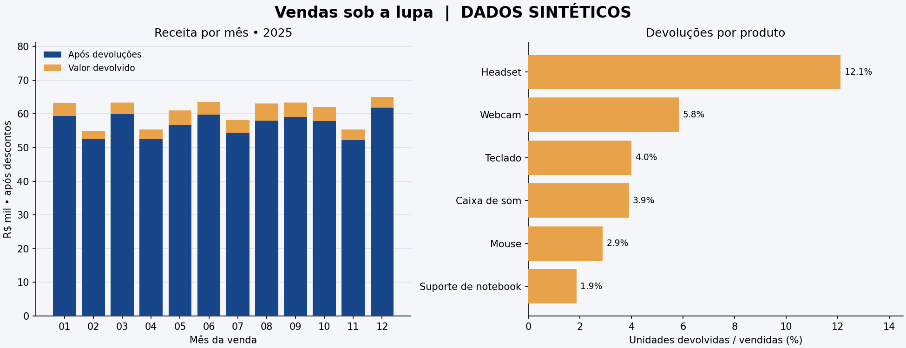

# Vendas e devoluções sob a lupa

Projeto de portfólio para responder: **quais produtos geram mais receita e quanto as devoluções reduzem esse valor?**

**Dados inteiramente sintéticos**, gerados com semente fixa. Nenhuma métrica representa uma empresa real. O objetivo é demonstrar um pipeline de dados reproduzível, do CSV bruto ao relatório.

## Resultado da execução padrão

| Indicador | Resultado |
| --- | ---: |
| Pedidos entregues válidos | 3.352 |
| Valor vendido após descontos | R$ 728.740,79 |
| Valor das devoluções | R$ 44.540,32 |
| Receita de mercadorias após devoluções | R$ 684.200,47 |
| Unidades devolvidas / vendidas | 5,11% |
| Valor devolvido / vendido | 6,11% |



O **headset** lidera a receita após devoluções e apresenta a maior taxa de devolução por unidade: **12,11%**. A hipótese de investigação seria verificar os motivos dessas devoluções; a base não permite atribuir uma causa. As diferenças entre produtos foram programadas no gerador, portanto não são descobertas sobre consumidores reais.

Leia a [análise completa](reports/RELATORIO.md), o [dicionário dos dados](DICIONARIO.md) e a [validação executada](VALIDACAO.md).

## Executar em poucos passos

Validado em **Python 3.12.14**, com versões de bibliotecas fixadas em `requirements.txt`. Não exige API, credenciais ou serviço externo. A instalação inicial das dependências requer internet; a análise funciona offline.

1. Clone este repositório e entre na pasta:

   ```bash
   git clone https://github.com/thiaguinbn/dados-2026-11-08-vendas-devolucoes.git
   cd dados-2026-11-08-vendas-devolucoes
   ```

2. Crie e ative um ambiente virtual:

   ```bash
   python -m venv .venv
   ```

   No macOS/Linux: `source .venv/bin/activate`. No Windows (Prompt de Comando): `.venv\Scripts\activate.bat`. Se necessário, use `python3` no lugar de `python`.

3. Instale, teste e execute:

   ```bash
   python -m pip install -r requirements.txt
   python -m unittest discover -v
   python pipeline.py
   ```

4. Abra `reports/overview.png` e `reports/RELATORIO.md`. As tabelas CSV e os JSONs de métricas ficam em `reports/`; os dados brutos, tratados, a quarentena e o banco SQLite ficam em `data/` (gerados localmente e excluídos do Git).

Outra simulação, com os mesmos critérios:

```bash
python pipeline.py --seed 7 --orders 5000 --output-dir reports/seed-7
```

O pipeline sempre regenera os dados locais. Outra semente muda os resultados; o comando acima preserva os relatórios padrão em `reports/`, mas substitui os arquivos intermediários em `data/`.

## Como funciona

| Arquivo | Responsabilidade |
| --- | --- |
| `generate_data.py` | Gera 3.600 pedidos-base e anomalias intencionais com semente 42 |
| `clean_data.py` | Valida esquema, deduplica, rejeita conflitos e separa cancelamentos |
| `metrics.sql` | Define indicadores, ranking por produto e série mensal com meses vazios |
| `pipeline.py` | Integra CSV, pandas, SQLite, SQL, Matplotlib e relatório |
| `test_clean_data.py` | Testa limpeza, valores monetários e regras de devolução |
| `test_metrics.py` | Confere SQL contra cálculos manuais e reconcilia agregações |

O código fica na raiz para permitir execução direta, sem instalação do projeto como pacote. São 13 métodos de teste, incluindo subcasos de entradas inválidas.

## Decisões de qualidade

- **Dinheiro em centavos inteiros:** evita usar ponto flutuante para somar valores monetários. O ticket médio é uma média calculada somente na apresentação.
- **Conflitos sem escolha arbitrária:** depois de remover duplicados exatos, todas as versões de um ID conflitante vão para a quarentena.
- **Auditoria reconciliável:** as 3.650 linhas de entrada são classificadas em 36 duplicadas, 4 conflitantes, 12 inválidas, 246 canceladas e 3.352 entregues válidas.
- **Taxa ponderada por unidades:** unidades devolvidas divididas pelas vendidas; não se usa média simples de percentuais.
- **Rastreabilidade:** o JSON de métricas registra semente, tamanho da base e hashes SHA-256 do CSV bruto e das consultas SQL.
- **Reprodução:** o mesmo comando com a mesma semente e ambiente produz as mesmas métricas. Não há horário de execução embutido no relatório.

## Limites e próximos passos

Esta é uma demonstração técnica com dados sintéticos. A receita após devoluções considera apenas mercadorias, sem frete, impostos, taxas ou custos; **não é lucro nem receita líquida contábil**. Os reembolsos são atribuídos ao mês da venda original, sem representar fluxo de caixa.

Cada pedido contém um único SKU; todos os desfechos são conhecidos. Não há clientes, sazonalidade real, estoque ou motivos de devolução. Para adaptar a uma operação real, seria necessário separar pedidos e itens, incluir datas de reembolso, validar o catálogo e a janela de devolução e documentar a fonte e as condições de uso dos dados. O validador atual é específico para o catálogo de demonstração e o ano de 2025.

Não foi adicionado machine learning: a pergunta é descritiva, e os agregados SQL respondem ao objetivo sem um modelo preditivo.

## Licença

Código e dados sintéticos gerados neste projeto: [MIT](LICENSE). O projeto foi desenvolvido com assistência de IA e validado pelos testes e pela execução descritos em `VALIDACAO.md`.
