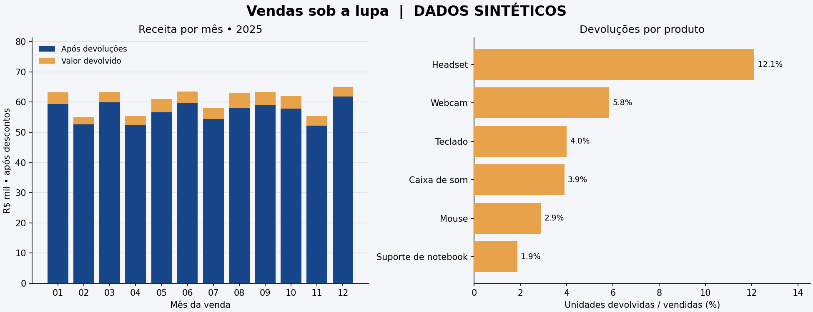

# Relatório — vendas e devoluções

> **Estudo com dados inteiramente sintéticos.** Não representa uma empresa, uma pesquisa de mercado ou uma estimativa de comportamento real.

## Pergunta

Quais produtos geram mais receita e quanto as devoluções reduzem esse valor?

## Indicadores calculados

| Indicador | Resultado |
| --- | ---: |
| Pedidos entregues válidos | 3352 |
| Unidades vendidas | 4987 |
| Unidades devolvidas | 255 |
| Valor vendido após descontos, antes das devoluções | R$ 728.740,79 |
| Valor das devoluções | R$ 44.540,32 |
| Receita de mercadorias após devoluções | R$ 684.200,47 |
| Taxa de devolução por unidade | 5.11% |
| Parcela do valor vendido devolvida | 6.11% |
| Ticket médio antes de devoluções | R$ 217,40 |

## Produtos

| Produto | Pedidos | Receita após devoluções | Devoluções por unidade | Valor devolvido |
| --- | ---: | ---: | ---: | ---: |
| Headset | 634 | R$ 183.415,75 | 12.11% | R$ 25.335,18 |
| Teclado | 677 | R$ 145.542,80 | 4.00% | R$ 6.028,33 |
| Mouse | 920 | R$ 114.674,12 | 2.89% | R$ 3.407,27 |
| Webcam | 315 | R$ 82.689,24 | 5.83% | R$ 5.047,53 |
| Caixa de som | 333 | R$ 80.272,08 | 3.90% | R$ 3.229,24 |
| Suporte de notebook | 473 | R$ 77.606,48 | 1.87% | R$ 1.492,77 |

## Interpretação

- **Headset** lidera a receita após devoluções nesta simulação, com R$ 183.415,75.
- **Headset** tem a maior taxa de devolução por unidade (12.11%) e responde por 56.88% do valor total devolvido.
- Em uma operação real, esse segundo resultado justificaria investigar motivos de devolução, fornecedor e especificações do produto. A base não contém essas informações; portanto, não permite atribuir uma causa.
- As diferenças entre produtos foram deliberadamente inseridas no gerador. Recuperá-las demonstra o funcionamento do pipeline; não é uma descoberta sobre consumidores reais.

## Auditoria de qualidade

| Etapa | Linhas |
| --- | ---: |
| `input_rows` | 3650 |
| `exact_duplicates_removed` | 36 |
| `conflicting_rows_rejected` | 4 |
| `invalid_rows_rejected` | 12 |
| `cancelled_orders_excluded` | 246 |
| `valid_delivered_orders` | 3352 |

As categorias após `input_rows` são exclusivas e somam exatamente a entrada. Duplicados exatos são removidos primeiro; IDs com versões diferentes são integralmente rejeitados; regras inválidas são quarentenadas; cancelados válidos não entram na receita.

## Definições e limites

- Cada pedido tem um único produto. Devoluções podem ser parciais.
- Valores são armazenados em centavos inteiros; descontos são arredondados por unidade no gerador antes da agregação.
- `gross_cents` significa valor de mercadorias após desconto e antes de devoluções; `net_cents = gross_cents - refund_cents`. Não é lucro nem receita líquida contábil: impostos, frete, custos e taxas não estão incluídos.
- Taxa por unidade = soma das unidades devolvidas / soma das unidades vendidas. Não é a média simples das taxas dos pedidos nem a fração de pedidos com devolução.
- Os reembolsos são atribuídos ao mês da venda original. Não existe data de reembolso; o gráfico não representa fluxo de caixa.
- Todos os pedidos simulados têm desfecho conhecido. O período é restrito a 2025; o gerador não modela sazonalidade real.
- Sem clientes, aquisição, custos ou estoque, não se pode calcular retenção, CAC, LTV ou margem.

## Reprodução e rastreabilidade

- Semente: `42`; pedidos-base: `3600`.
- SHA-256 do CSV bruto: `c41e426be1c6676279a6d2e1a915d148fb3a488f8b9240679a464b695a36055d`.
- SHA-256 do SQL: `17c5c5c164a4b1b830e32d688ca7499182bd2cb9cce2501180dda4ab5d6f6725`.
- Métricas completas: [metrics.json](metrics.json); tabelas: [products.csv](products.csv) e [monthly.csv](monthly.csv); auditoria: [quality.json](quality.json).

Reexecute com `python pipeline.py`. Veja o README para instalar dependências e rodar os testes. O uso de outra semente cria outra simulação e pode mudar os resultados.
